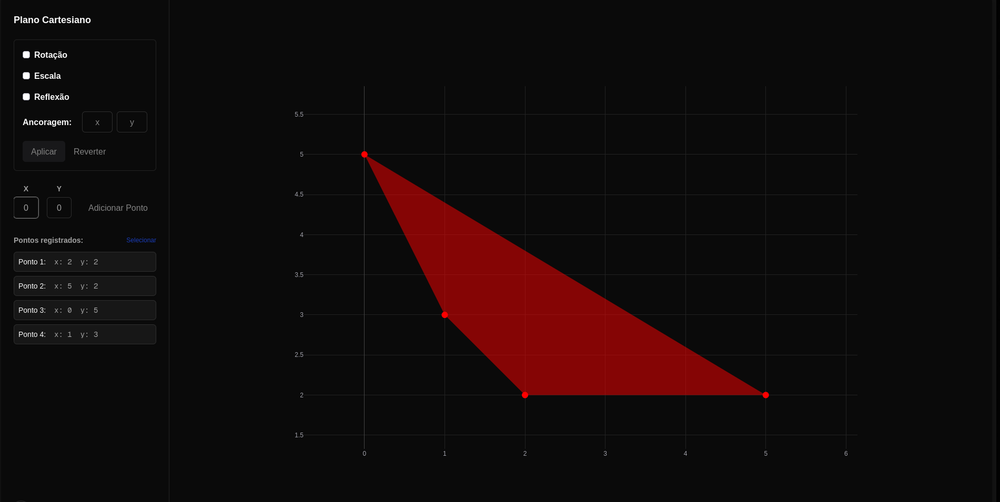

# Vetorize

Aplicação web para explorar transformações geométricas no plano cartesiano, desenvolvida como trabalho de Álgebra Linear. Permite cadastrar pontos e visualizar os efeitos de rotação, escala e reflexão.



## Tecnologias

- **Next.js 16 e React 19:** estrutura da aplicação e interface.
- **TypeScript:** tipagem dos pontos, matrizes e transformações.
- **Plotly.js:** gráfico interativo com zoom e deslocamento.
- **Tailwind CSS 4:** estilização.

## Como executar

Com Node.js 20.9 ou superior e npm instalados, execute na pasta do projeto:

```bash
npm ci
npm run dev
```

Acesse [http://localhost:3000](http://localhost:3000). Não há variáveis de ambiente obrigatórias nem banco de dados configurado. O layout utiliza fontes do Google via `next/font`, que precisam ser obtidas durante a compilação.

| Comando | Função |
| --- | --- |
| `npm run dev` | Inicia o ambiente de desenvolvimento. |
| `npm run build` | Gera a versão de produção. |
| `npm start` | Inicia a versão de produção após o build. |
| `npm run lint` | Executa a análise estática com ESLint. |

## Como usar

Na página inicial, escolha o módulo desejado. Na página **Pontos** (`/pontos`):

1. Informe as coordenadas **X** e **Y** e clique em **Adicionar Ponto**. Pontos duplicados são rejeitados.
2. Adicione, por exemplo, `(0, 0)`, `(4, 0)` e `(0, 3)` para visualizar um triângulo.
3. Marque as transformações desejadas: **Rotação** (ângulo em graus), **Escala** (fatores Sx e Sy) ou **Reflexão** (X, Y ou origem).
4. Preencha as duas coordenadas de **Ancoragem** para definir o ponto de referência. Caso contrário, é usada a média das coordenadas dos pontos (centroide).
5. Clique em **Aplicar**. Quando combinadas, as operações seguem a ordem: escala → rotação → reflexão, todas relativas à mesma âncora. Para usar os eixos globais nas reflexões, informe a âncora `(0, 0)`.
6. Use **Reverter** para desfazer uma operação por vez. Para remover pontos, clique em **Selecionar**, marque os desejados e escolha **Excluir**.

## Organização e funcionamento

A aplicação é dividida em rotas (`src/app/`) e módulos de funcionalidade (`src/features/`). As rotas são finas: definem layout, metadata e compõem os componentes exportados pela feature. Código genérico, reaproveitável entre páginas, fica em `src/utils/` e `src/types/`. Os imports usam o alias `@/` (aponta para `src/`).

Na feature de pontos, os formulários atualizam o estado em `PointsContext`, disponível apenas dentro da rota `/pontos`. As funções matemáticas transformam as coordenadas, e o gráfico é atualizado automaticamente. Os pontos são representados por pares `[x, y]`; ao adicionar o terceiro ponto ou mais, são ordenados pelo ângulo em torno do centroide.

| Caminho | Responsabilidade |
| --- | --- |
| `src/app/layout.tsx` | Layout raiz: fontes, header global e estilos globais. |
| `src/app/page.tsx` | Página inicial com a lista de módulos. |
| `src/app/pontos/` | Rota `/pontos`: layout com o provedor de estado e composição da página. |
| `src/components/layout/AppHeader.tsx` | Navegação global. |
| `src/config/navigation.ts` | Registro das páginas exibidas no header e na página inicial. |
| `src/features/pontos/index.ts` | API pública da feature (o que as rotas podem importar). |
| `src/features/pontos/components/PontoManager.tsx` | Organiza o painel lateral. |
| `src/features/pontos/components/PontoInput.tsx` | Formulário de cadastro de pontos. |
| `src/features/pontos/components/PontoList.tsx` | Listagem, seleção e exclusão de pontos. |
| `src/features/pontos/components/PontoTrans.tsx` | Controles de transformação, ancoragem e reversão. |
| `src/features/pontos/components/PointsChart.tsx` | Gráfico interativo (Plotly). |
| `src/features/pontos/context/PointsContext.tsx` | Gerencia pontos, matrizes de transformação e histórico de inversas. |
| `src/features/pontos/types.ts` | Tipos específicos da feature. |
| `src/utils/` | Operações matriciais e validação dos formatos de vetores e matrizes. |
| `src/types/` | Tipos compartilhados (`Vector`, `Matrix`). |

### Adicionando uma nova página

1. Crie a feature em `src/features/<nome>/` com seus componentes e um `index.ts` exportando a API pública.
2. Crie a rota em `src/app/<nome>/page.tsx` (e `layout.tsx`, se precisar de provider ou metadata próprios).
3. Adicione uma entrada em `NAVIGATION_ITEMS` (`src/config/navigation.ts`) para que ela apareça no header e na página inicial.

## Limitações atuais

- Os dados ficam apenas na memória do navegador e são perdidos ao recarregar a página ou sair da rota `/pontos`.
- A reversão usa matrizes inversas e não desfaz cadastros ou exclusões de pontos. Fatores de escala iguais a zero não possuem inversa e não são tratados pelo código.
- Não há suíte de testes automatizados configurada. Para uma verificação manual, use o triângulo do exemplo, aplique rotação de 90° com âncora `(0, 0)` e confira os pontos `(0, 0)`, `(0, 4)` e `(-3, 0)`; depois use **Reverter**.
