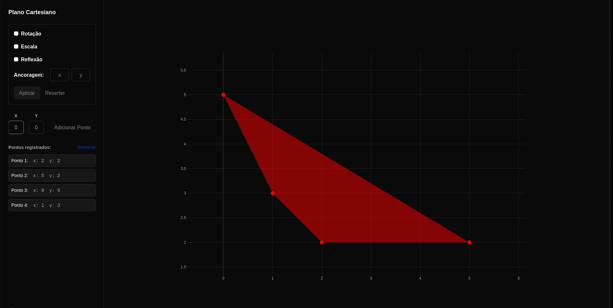

# Vetorize

Aplicação web para explorar transformações geométricas no plano cartesiano, desenvolvida como trabalho de Álgebra Linear. Permite cadastrar pontos e visualizar os efeitos de rotação, escala e reflexão.



## Tecnologias

- **Next.js 16 e React 19:** estrutura da aplicação e interface.
- **TypeScript:** tipagem dos pontos, matrizes e transformações.
- **Plotly.js:** gráfico interativo com zoom e deslocamento.
- **Tailwind CSS 4:** estilização.

## Como executar

Com Node.js 20.9 ou superior e npm instalados, execute na pasta do projeto:

```bash
npm ci
npm run dev
```

Acesse [http://localhost:3000](http://localhost:3000). Não há variáveis de ambiente obrigatórias nem banco de dados configurado. O layout utiliza fontes do Google via `next/font`, que precisam ser obtidas durante a compilação.

| Comando | Função |
| --- | --- |
| `npm run dev` | Inicia o ambiente de desenvolvimento. |
| `npm run build` | Gera a versão de produção. |
| `npm start` | Inicia a versão de produção após o build. |
| `npm run lint` | Executa a análise estática com ESLint. |

## Como usar

Na página inicial, escolha o módulo desejado. Na página **Pontos** (`/pontos`):

1. Informe as coordenadas **X** e **Y** e clique em **Adicionar Ponto**. Pontos duplicados são rejeitados.
2. Adicione, por exemplo, `(0, 0)`, `(4, 0)` e `(0, 3)` para visualizar um triângulo.
3. Marque as transformações desejadas: **Rotação** (ângulo em graus), **Escala** (fatores Sx e Sy) ou **Reflexão** (X, Y ou origem).
4. Preencha as duas coordenadas de **Ancoragem** para definir o ponto de referência. Caso contrário, é usada a média das coordenadas dos pontos (centroide).
5. Clique em **Aplicar**. Quando combinadas, as operações seguem a ordem: escala → rotação → reflexão, todas relativas à mesma âncora. Para usar os eixos globais nas reflexões, informe a âncora `(0, 0)`.
6. Use **Reverter** para desfazer uma operação por vez. Para remover pontos, clique em **Selecionar**, marque os desejados e escolha **Excluir**.

